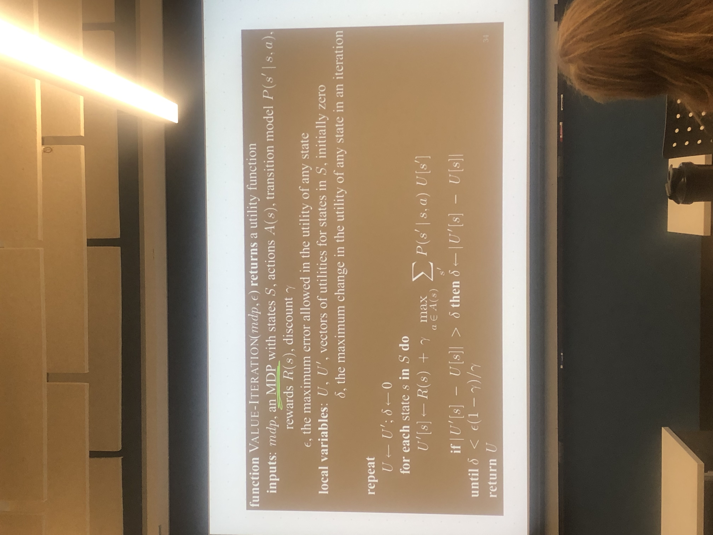
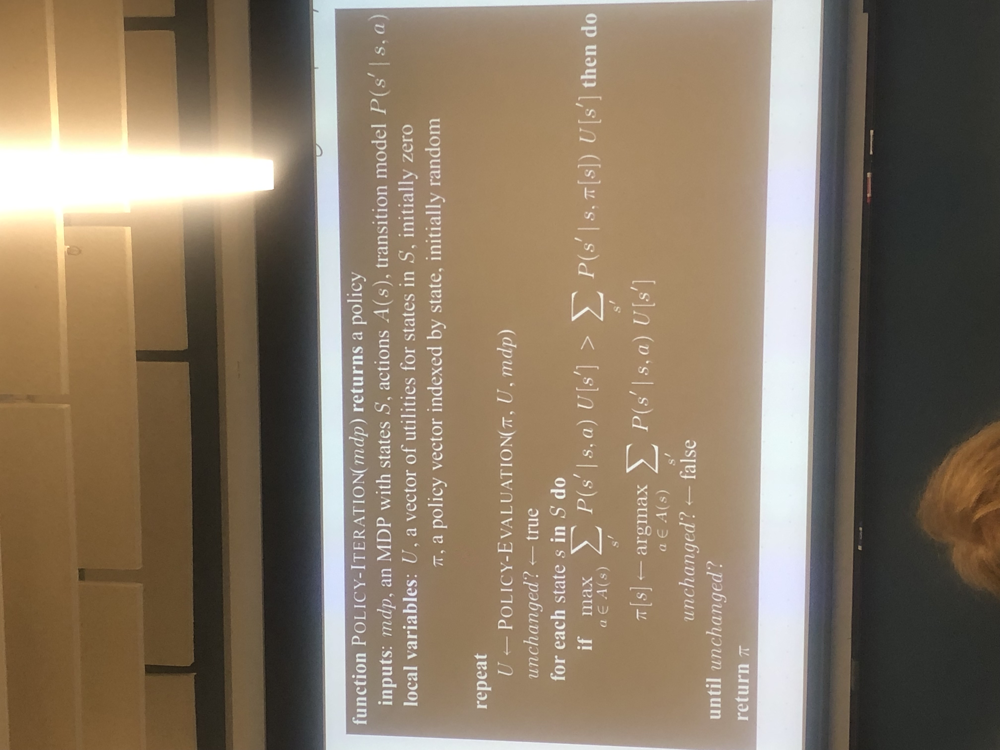

# Friday September 25, 2026

## Value Iteration

- Keeps going until delta converges.
- Assumes this will converge.

-Proof SKetch (also in textbook):
	bellman equations are a contraction
		ex: y = x/2
		-The equation will always bring two utilities closer together.
		-Contractions have a unique fixed point
			f(x) = x    x = 0
			f(p) = p    p = 0
		-Repeatedly applying contractions leads to a fixed point

-How do we know when it comnverges?
	$\delta$ < $\epsilon$(1-$\gamma$)/$\gamma$

	-But we don't care about utilities, just policy!

## Policy Iteration

-Policy eventually doesn't change.
	- Don't need $\epsilon$ or $\delta$

- Differences:
	1. Value keeps track of utilities and updates utility.
	2. Policy keeps track of policy for better utilities.